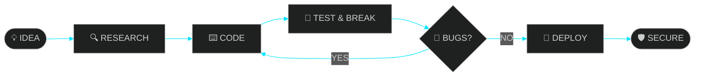

<!-- ╔════════════════════════════════════════════════════════════╗
     ║   CYBER PROFILE v2.0  ·  N LAVANYA  ·  nlavanyanlavanya60  ║
     ╚════════════════════════════════════════════════════════════╝ -->

<div align="center">


<a href="https://github.com/nlavanyanlavanya60-netize">

</a>

<br/>


</div>


<!-- ═══════════════ TERMINAL ═══════════════ -->

## 🖥️ `root@lavanya:~# whoami`

```ansi
┌──────────────────────────────────────────────────────────────┐
│ ● ● ●                  lavanya@cyber-node : ~                │
├──────────────────────────────────────────────────────────────┤
│                                                              │
│  ██╗      █████╗ ██╗   ██╗ █████╗ ███╗   ██╗██╗   ██╗ █████╗ │
│  ██║     ██╔══██╗██║   ██║██╔══██╗████╗  ██║╚██╗ ██╔╝██╔══██╗│
│  ██║     ███████║██║   ██║███████║██╔██╗ ██║ ╚████╔╝ ███████║│
│  ██║     ██╔══██║╚██╗ ██╔╝██╔══██║██║╚██╗██║  ╚██╔╝  ██╔══██║│
│  ███████╗██║  ██║ ╚████╔╝ ██║  ██║██║ ╚████║   ██║   ██║  ██║│
│  ╚══════╝╚═╝  ╚═╝  ╚═══╝  ╚═╝  ╚═╝╚═╝  ╚═══╝   ╚═╝   ╚═╝  ╚═╝│
│                                                              │
│  USER      : N Lavanya                                       │
│  ALIAS     : nlavanyanlavanya60-netize                       │
│  CLASS     : Developer · Security Enthusiast · Hacker-in-making │
│  DOMAINS   : Cyber Security | AI/ML | Mobile Apps | Web      │
│  MISSION   : Build smart tools that protect & solve problems │
│  STATUS    : [●] ONLINE — learning, building, breaking, fixing│
│                                                              │
└──────────────────────────────────────────────────────────────┘
```


<!-- ═══════════════ CURRENT MISSIONS ═══════════════ -->

## 🎯 `./current_missions.sh`

<table>
<tr>
<td width="50%">

```diff
+ 🔭 Currently exploring  : Cyber Security & Threat Detection
+ 🌱 Currently learning   : Machine Learning, Ethical Hacking
+ 🛠️ Currently building   : Security tools & AI-powered apps
+ 🏆 Participating in    : Hackathons & CTF challenges
```

</td>
<td width="50%">

```diff
- ❌ Bugs         : being hunted
- ❌ Malware      : being detected
! ⚠️ Coffee level : critically low
# 💬 Ask me about : Python, Security, Flutter
```

</td>
</tr>
</table>


<!-- ═══════════════ ARSENAL ═══════════════ -->

## ⚔️ `nmap --arsenal localhost`

<div align="center">


<br/><br/>


</div>

### 📊 Skill Levels

```text
Python        [██████████████████░░]  90%
Cyber Sec     [███████████████░░░░░]  75%
JavaScript    [██████████████░░░░░░]  70%
AI / ML       [█████████████░░░░░░░]  65%
Flutter/Dart  [████████████░░░░░░░░]  60%
```

> ✏️ *Change the percentages to match your real skill level.*


<!-- ═══════════════ PROJECTS ═══════════════ -->

## 🗂️ `ls -la ~/projects`

<div align="center">

<table>
<tr>
<td align="center" width="33%">
<a href="https://github.com/nlavanyanlavanya60-netize/Enhanced-Keylogger-Detector">

</a>
</td>
<td align="center" width="33%">
<a href="https://github.com/nlavanyanlavanya60-netize/CropDiseaseProject">

</a>
</td>
<td align="center" width="33%">
<a href="https://github.com/nlavanyanlavanya60-netize/Find-My-Phone">

</a>
</td>
</tr>
<tr>
<td align="center" width="33%">
<a href="https://github.com/nlavanyanlavanya60-netize/Quiz_CXH">

</a>
</td>
<td align="center" width="33%">
<a href="https://github.com/nlavanyanlavanya60-netize/Hackthon">

</a>
</td>
<td align="center" width="33%">
<a href="https://github.com/nlavanyanlavanya60-netize?tab=repositories">

</a>
</td>
</tr>
</table>

</div>

### 🔐 Mission Briefing

| 🛰️ CODENAME | ⚙️ STACK | 📡 OBJECTIVE | ☠️ THREAT LEVEL |
|:--|:--:|:--|:--:|
| **Keylogger Detector** | `Python` | Detect suspicious keylogging activity & protect input | 🔴 HIGH |
| **Crop Disease Project** | `Python` `AI` | Identify crop diseases to help farmers | 🟢 LOW |
| **Find My Phone** | `Dart` `Flutter` | Locate a lost or stolen phone | 🟡 MEDIUM |
| **Quiz CXH** | `JavaScript` | Interactive quiz web app | 🟢 LOW |
| **Hackthon** | `Python` | Hackathon project built under pressure | 🟡 MEDIUM |

> ✏️ *Descriptions are written from repo names — edit them to match your projects.*


<!-- ═══════════════ WORKFLOW DIAGRAM ═══════════════ -->

## 🧬 `cat /etc/workflow.conf`




<!-- ═══════════════ STATS ═══════════════ -->

## 📈 `tail -f /var/log/github_stats`

<div align="center">


<br/>


<br/><br/>


</div>


<!-- ═══════════════ TROPHIES ═══════════════ -->

## 🏆 `cat achievements.log`

<div align="center">


</div>


<!-- ═══════════════ SNAKE ═══════════════ -->

## 🐍 `./snake.exe --eat-contributions`

<div align="center">

<picture>
  <source media="(prefers-color-scheme: dark)" srcset="https://raw.githubusercontent.com/nlavanyanlavanya60-netize/nlavanyanlavanya60-netize/output/github-snake-dark.svg" />
  
</picture>

</div>

> 🐍 *The snake appears after you add `.github/workflows/snake.yml` (included) and run the workflow once.*


<!-- ═══════════════ HACKER FACTS ═══════════════ -->

<details>
<summary><b>🔓 CLICK TO DECRYPT — SECRET FILE</b></summary>
<br/>

```bash
$ sudo cat /secret/facts.txt
[sudo] password for lavanya: ********

>> Fun fact #1 : I debug in my sleep
>> Fun fact #2 : "It works on my machine" is my catchphrase
>> Fun fact #3 : I believe every bug is just an undiscovered feature
>> Fun fact #4 : Add your own secret fact here...

$ exit
```

</details>


<!-- ═══════════════ CONTACT ═══════════════ -->

## 📡 `ping lavanya --secure-channel`

<div align="center">

<a href="https://github.com/nlavanyanlavanya60-netize"></a>
<a href="https://www.linkedin.com/in/YOUR-LINKEDIN"></a>
<a href="mailto:YOUR-EMAIL@gmail.com"></a>

<br/><br/>

```text
╔══════════════════════════════════════════════════════╗
║                                                      ║
║    "Security is not a product, it's a process."      ║
║                            — Bruce Schneier          ║
║                                                      ║
║    [●] CONNECTION SECURE      [●] ENCRYPTION: AES-256 ║
║                                                      ║
╚══════════════════════════════════════════════════════╝
```


</div>
